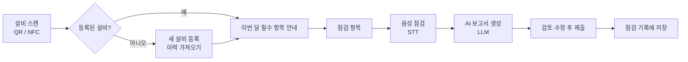
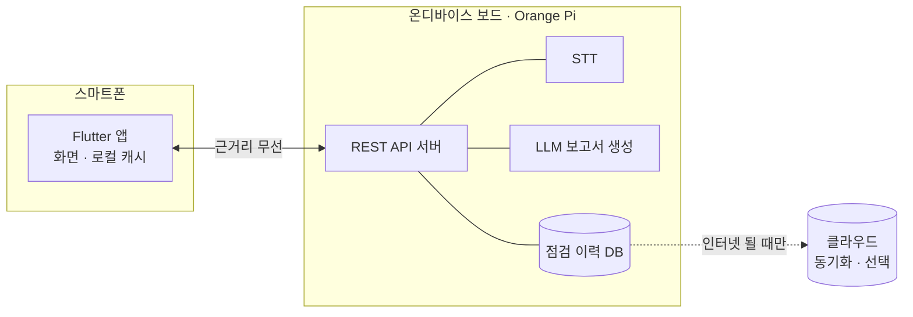

<div align="center">

# 🛗 에스컬레이터 음성 점검 보조 앱

**장갑 낀 손 그대로, 말로 끝내는 에스컬레이터 점검**

음성 기반 온디바이스 AI 점검 보조 시스템


</div>

---

## 📌 소개

지하철역과 대형 쇼핑몰의 에스컬레이터를 점검하는 기사님은 기름 묻은 장갑을 낀 채 종이 점검표를 채우고,
퇴근 전 사무실에서 같은 내용을 시스템에 다시 입력합니다. 지하 기계실은 네트워크도 잘 잡히지 않습니다.

이 앱은 **QR/NFC로 설비를 인식**하고, **말로 점검 결과를 남기면** 휴대용 온디바이스 보드가
**STT + LLM으로 표준 점검 보고서를 자동 완성**합니다. 인터넷이 없어도 모든 과정이 동작합니다.

> "작업하면서 '브레이크 상태 양호'라고 말만 해도 보고서가 자동 완성되고 누락까지 잡아준다면 안 쓸 이유가 없죠."
> — 승강기 유지보수 15년 차 선임 기사 페르소나

## 🎯 해결하는 문제

| 현장의 불편 | 앱의 해결 방법 |
| --- | --- |
| 장갑을 벗고 종이에 수기 작성 | 음성으로 기록, 장갑 낀 채 누를 수 있는 큰 버튼 |
| 사무실 복귀 후 시스템에 재입력 (1~2시간) | 점검 종료와 동시에 보고서 자동 완성 |
| 항목별 점검 주기(1·3·6·12개월)가 달라 누락 위험 | 설비 스캔 시 이번 달 필수 항목·지연 항목 자동 안내 |
| 지하 기계실 네트워크 음영 | 온디바이스 보드에서 STT·LLM·DB 처리, 오프라인 100% 동작 |
| 치수 측정값 이상 여부를 일일이 대조 | 기준치와 비교해 정상/이상 자동 판정 |

## ✨ 주요 기능

- **설비 스캔 (QR / NFC)** — 스캔 한 번으로 설비 정보, 기본제원, 이번 달 필수 점검 항목 확인
- **새 설비 등록** — 처음 보는 설비도 QR로 등록하고 온디바이스 DB에 있는 이력을 바로 가져오기
- **AI 가이드 음성 점검** — 마이크 버튼 하나로 점검 내용을 말하면 실시간 텍스트 변환
- **AI 보고서 검토·수정** — 부위별 상태(정상/주의/긴급)와 이상 소견을 확인하고 원문 수정 후 제출
- **점검 기록·이력 조회** — 설비별 타임라인, 항목 음성 검색, 주의 건만 모아보기

## 📱 화면 구성

| 프레임 | 화면 | 파일 | 담당 |
| --- | --- | --- | --- |
| 1 | 설비 스캔 (QR/NFC, 최근 점검) | `screens/scan_screen.dart` | 조해리 |
| 2 | 점검 기록 · 설비 이력 | `screens/home_screen.dart` | 조해리 |
| 3 | 점검 항목 | `screens/inspection_screen.dart` | 박나현 |
| 5 | 음성 점검 | `screens/voice_inspection_screen.dart` | 박나현 |
| 4 | 점검 결과 확인·수정 | `screens/result_screen.dart` | 박나현 |

<!-- 스크린샷: docs/screenshots/ 에 이미지를 넣고 아래 주석을 풀어 주세요
<p align="center">
  
  
  
  
</p>
-->

### 점검 흐름



## 🏗 시스템 구조



- 앱은 보드의 API를 먼저 호출하고, 받은 데이터는 폰에 캐시합니다.
- 보드와 연결이 끊기면 마지막으로 받은 이력을 보여주고, 연결되면 자동으로 다시 동기화합니다.

## 🛠 기술 스택

| 구분 | 사용 기술 |
| --- | --- |
| 앱 | Flutter (Dart 3), Material 3 |
| 통신 · 저장 | `http`, `shared_preferences` |
| 온디바이스 | Orange Pi, STT, LLM |
| 협업 | GitHub, Figma, Notion |

## 📂 폴더 구조

```
lib/
├── main.dart                     # 앱 시작점, 라우트 설정
├── constants/
│   └── app_theme.dart            # 공통 색상·테마
├── models/
│   ├── equipment.dart            # 설비 · 기본제원 · 점검 기록 · 점검 주기
│   └── inspection_item.dart      # 점검 항목 (프레임 3)
├── controllers/
│   ├── api_client.dart           # REST API 호출
│   ├── equipment_repository.dart # API → 캐시 → 더미 데이터 순 조회
│   └── on_device_db.dart         # 보드 연동 전 개발·시연용 더미 데이터
├── screens/
│   ├── main_shell.dart           # 하단 탭 (설비 스캔 / 점검 기록)
│   ├── scan_screen.dart          # 프레임 1
│   ├── home_screen.dart          # 프레임 2
│   ├── inspection_screen.dart    # 프레임 3
│   └── voice_inspection_screen.dart  # 프레임 5
└── widgets/
    ├── common_widgets.dart       # 헤더, 카드, 배지, 기본제원 카드 등
    └── equipment_sheet.dart      # 스캔 결과 바텀시트
```

## 🚀 실행 방법

```bash
git clone <저장소 주소>
cd <프로젝트 폴더>
flutter pub get
flutter run
```

- 기본 설정은 **보드 없이 더미 데이터로 동작**합니다. 설비 스캔 탭에서 스캔 박스를 누르면 테스트용 QR을 고를 수 있습니다.
- Android Studio에서 실행할 때는 실행 설정이 **Flutter**로 잡혀 있는지 확인하세요. (Dart Command Line App으로 실행하면 `dart:ui` 오류가 납니다.)

### 온디바이스 보드 연결

1. `lib/controllers/api_client.dart`
   - `useServer = true`
   - `baseUrl = 'http://<보드 IP>:<포트>'`
2. `android/app/src/main/AndroidManifest.xml`의 `<application>`에 `android:usesCleartextTraffic="true"` 추가
3. 응답 필드명이 다르면 `models/equipment.dart`의 `fromJson`만 수정

## 🔌 API

| 화면 | Method | Endpoint |
| --- | --- | --- |
| QR / NFC 스캔, 설비 정보 | `GET` | `/api/escalators/{escalatorId}` |
| 최근 점검 이력, 점검 기록, 설비 이력 | `GET` | `/api/escalators/{escalatorId}/histories` |
| 점검 항목 | `GET` | `/api/escalators/{escalatorId}/items` |
| 체크박스 | `PATCH` | `/api/escalators/{escalatorId}/items/{itemId}` |
| 음성 점검 기록 | `POST` | `/api/inspections/voice` |
| 점검 결과 요약 | `GET` | `/api/inspections/{inspectionId}/result` |
| 점검 항목 결과 수정 | `PATCH` | `/api/inspections/{inspectionId}/items/{itemId}` |
| 최종 결과 저장·제출 | `POST` | `/api/inspections/{inspectionId}/submit` |

자세한 요청·응답 형식은 팀 노션의 API 명세서를 참고하세요.

## 🌿 브랜치 · 커밋 규칙

- 각자 개인 브랜치에서 작업한 뒤 PR로 합칩니다.
- 로컬 브랜치는 **같은 이름의 원격 브랜치**를 따라가게 설정합니다: `git branch -u origin/<내 브랜치>`
- `.idea/workspace.xml` 등 IDE 개인 설정 파일은 커밋하지 않습니다.

| 태그 | 의미 |
| --- | --- |
| `feat` | 새 기능 |
| `fix` | 버그 수정 |
| `design` | UI·스타일 변경 |
| `refactor` | 동작 변화 없는 코드 정리 |
| `docs` | 문서 수정 |
| `chore` | 설정·패키지 변경 |

## 👥 팀

| 이름 | 역할 |
| --- | --- |
| 조해리 | 프론트엔드 — 설비 스캔, 점검 기록·이력 |
| 박나현 | 프론트엔드 - 점검 항목 및 음성 인식 화면 |
| | |
| | |
